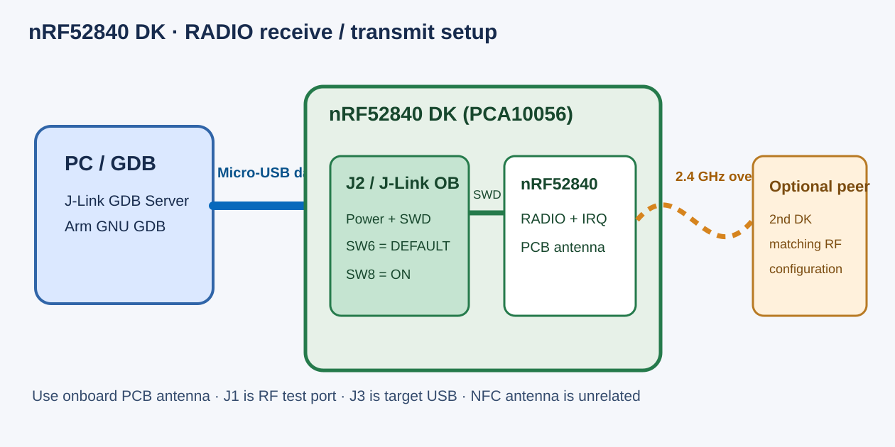

# nRF52840 DK 真机调试与 RADIO 收发用例

本目录对应 **nRF52840 Development Kit（PCA10056）**，板载 nRF52840、SEGGER J-Link OB 调试器和 2.4 GHz PCB 走线天线。实验选择研究仓库中的 `radio_receiver` 与 `radio_transmitter` 两个单元测试；每个目录含相互对应的 `.axf`（ELF/调试）与 `.bin`。先确认实物 PCB 标记为 PCA10056，而非外形不同的 nRF52840 Dongle。




## 准备什么、插哪里

| 物品 | 接法与作用 |
| --- | --- |
| nRF52840 DK（PCA10056） | 被测真机；**SW8 Power = ON**、**SW6 nRF ONLY = DEFAULT**，常规供电保持 SW9 的 VDD 默认位置 |
| 一根可传数据的 **Micro-USB** 线 | 电脑 USB → 板上 **J2 / Interface MCU USB**；用于供电、J-Link、虚拟串口/RTT。不要把 **J3 / nRF USB** 当成常规 J-Link 调试口 |
| 板载 2.4 GHz PCB 天线 | BLE/RADIO 测试默认直接使用；**不用拿套件附送的 NFC 天线，也不必外接棒状天线** |
| 可选的第二块 nRF52840 DK 或协议匹配的 2.4 GHz 对端 | 产生接收测试所需的空中数据，或接收发送测试的数据；对端必须匹配频点、包格式和测试固件时序 |
| SEGGER J-Link 软件、Arm GNU GDB；可选 nRF Connect for VS Code / nRF Util | 烧录与 GDB 调试 |

官方硬件指南确认 **J2 是接口 MCU USB**、**J3 是目标 SoC USB**，板载 J-Link 和天线也有说明：[硬件概览](https://docs.nordicsemi.com/r/bundle/ug_nrf52840_dk/page/ug/dk/intro.html)、[供电接口](https://docs.nordicsemi.com/r/bundle/ug_nrf52840_dk/page/ug/dk/hw_power_supply.html)。板上 **J1 是带开关的 SWF 射频测量口**：默认不插探头时，射频走板载 PCB 天线；插入专用探头会断开板载天线，不能把普通 SMA 天线线缆直接当作必备接线。[Nordic RF 测量说明](https://docs.nordicsemi.com/r/bundle/ug_nrf52840_dk/page/ug/dk/hw_rf_measure.html)对此有明确说明。NFC 天线只服务 NFC 测试，与本次 2.4 GHz RADIO 收发无关。

## 烧录指定固件

1. 将数据线插到 J2 和电脑，打开 SW8，保持 SW6 在 DEFAULT。用 `nrfjprog --ids` 或 J-Link Commander 确认识别到板载 J-Link 序列号；多块板同时连接时记录该号并显式选板。旧目录中的 `nrfjprog` 命令仍可使用，但 [Nordic 已将 nRF Command Line Tools 归档并转向 nRF Util](https://docs.nordicsemi.com/r/bundle/ug_nrf_cltools/page/ug/cltools/nrf_command_line_tools_lpage.html)。常规烧录**不要执行 `--recover`**，它会擦除芯片保护状态及现有内容。
2. 在研究仓库 `examples/unit-tests/additional-tests/nRF52840/radio_receiver/` 选择 `nrf52840_xxaa_radio_receiver.axf`；发送实验则选 `radio_transmitter/nrf52840_xxaa_radio_transmitter.axf`。这两份是不同固件，改用另一份前保存前一份的日志、哈希与测量结果。`.axf` 含载入地址，适合 GDB `load`；如果只持有 `.bin`，必须确认其 Flash 起始地址后再编程，不能把裸二进制交给不知地址的工具。
3. 最直接的 GDB 烧录方式是在电脑终端启动 J-Link GDB Server（Windows 可用 `JLinkGDBServerCL.exe`，Linux/macOS 通常为 `JLinkGDBServer`）：

```sh
JLinkGDBServer -select USB -device nRF52840_xxAA -if SWD -speed 4000 -port 2331
arm-none-eabi-gdb nrf52840_xxaa_radio_receiver.axf
```

GDB 内执行：

```gdb
target remote localhost:2331
monitor reset
load
monitor reset
break main
continue
```

发送实验把 GDB 打开的 AXF 换成 `nrf52840_xxaa_radio_transmitter.axf`。如使用 nRF Connect for VS Code，可在扩展的设备列表核对 J-Link ID、创建匹配 PCA10056/nRF52840 的调试配置，再指定本测试的 AXF；但现有固件不是已知的 nRF Connect SDK 工程，不应将 `west build/flash` 直接套用到预编译 AXF。已有 Zephyr 工程可按 [Zephyr nRF52840 DK 烧录/调试文档](https://docs.zephyrproject.org/latest/boards/nordic/nrf52840dk/doc/index.html)使用 `west`。

## RADIO RX/TX 如何测、如何记 GDB 路径

- **TX：**烧录 transmitter AXF，在 RADIO 配置、`TASKS_TXEN`、`EVENTS_READY`、`TASKS_START`、`EVENTS_END` 等关键点停住并记录寄存器、`PACKETPTR` 缓冲区与中断。若需验证真实空中帧，用一块频点/格式匹配的接收板或合适的 2.4 GHz 仪器。电脑和被测板之间只需 J2 的 USB 调试线；不额外接射频天线。
- **RX：**烧录 receiver AXF，启动前先准备无线对端发送**与测试固件一致**的信道、地址、包配置和时序。单块板能观察 RX 进入等待状态，却不能仅凭未收到包判定模型错误。记录 `TASKS_RXEN`、`EVENTS_READY`、`TASKS_START`、`EVENTS_END`、`CRCSTATUS`、`PACKETPTR`、IRQ 和接收缓冲区；把发送端输入及时间点一起留档。
- 两种用例都应固定 AXF SHA-256、板号/PCB revision、J-Link ID、对端固件、调试日志和 GDB 断点。在仿真器用同一 AXF/输入重放，并按关键函数与 MMIO 读写顺序比较中间行为；**当前这份指南是上板方案，不代表已完成真实板测试**。

如果需要双板互发，用第二块 PCA10056 作为对端最容易固定条件；两块板各自以 Micro-USB 数据线接电脑 **J2**，各自使用板载天线。若后续证实原始 receiver/transmitter 固件的无线参数彼此不兼容，应以源码和寄存器配置为准修改对端固件，不能直接宣称二者能够互通。

## 参考

- [Nordic nRF52840 DK 硬件指南](https://docs.nordicsemi.com/r/bundle/ug_nrf52840_dk/page/ug/dk/intro.html)
- [Nordic J2/J3 供电接口](https://docs.nordicsemi.com/r/bundle/ug_nrf52840_dk/page/ug/dk/hw_power_supply.html)
- [Nordic J1 与板载 PCB 天线切换](https://docs.nordicsemi.com/r/bundle/ug_nrf52840_dk/page/ug/dk/hw_rf_measure.html)
- [Nordic nRF Command Line Tools 状态](https://docs.nordicsemi.com/r/bundle/ug_nrf_cltools/page/ug/cltools/nrf_command_line_tools_lpage.html)
