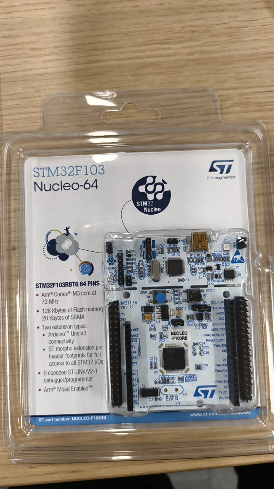
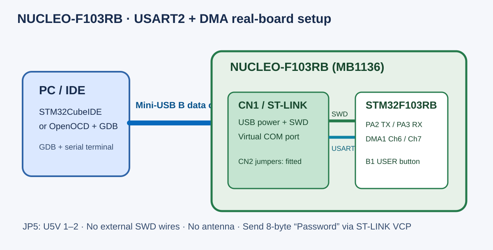

# NUCLEO-F103RB 真机调试与 USART2 DMA 用例

实验室实物为 **NUCLEO-F103RB**，包装和 PCB 标有 `STM32F103RBT6`、`MB1136 rev C`，板上自带 ST-LINK/V2-1。它不是 STM32F103C8T6 “Blue Pill”。下图是实验室实物；接线示意图标明了本任务需要的接口。





## 准备什么

| 物品 | 用途 |
| --- | --- |
| NUCLEO-F103RB（STM32F103RBT6，MB1136 rev C） | 被测真机 |
| 一根可传数据的 **Mini-USB B** 线和电脑 | 接板上 **CN1 / ST-LINK USB**；同时供电、烧录、SWD 调试及虚拟串口 |
| STM32CubeIDE / STM32CubeProgrammer，或 OpenOCD + Arm GNU GDB | 图形化或命令行烧录、调试 |
| `stm32f103_usart_contiguous.elf`（首选）及同版本 `.bin` | USART2 + DMA 单元测试；ELF 提供符号，BIN 只供烧录 |
| 2.4 GHz 天线 | **不需要**：STM32F103RB 没有本任务使用的无线电 |

目标固件位于研究仓库 `examples/unit-tests/gdma-extended/STM32F103/`。选择这份固件是因为其 USART2 接收与 DMA1 通道 6/7 路径与已有仿真用例一致。务必用同一构建的 ELF 与 BIN；若以后重编，先确认目标确为 **STM32F103RB**、向量表位于 `0x08000000`、Flash/RAM 布局与板上器件一致。当前 BIN 的初始 SP 为 `0x20005000`、复位向量为 `0x08000231`，这只证明基本地址合理，**尚不代表已在实物上跑通**。

## 插线与上电

1. 保持板载 ST-LINK 与目标 MCU 间 **CN2 两个跳帽**装在原位。采用 USB 供电时，核对 **JP5 接 1–2（U5V）**；不要把 CN4 外部 SWD 口当作电脑 USB 口。上述名称和位置见 [ST 的 MB1136 用户手册 UM1724](https://www.st.com/resource/en/user_manual/dm00105823-stm32-nucleo-64-boards-mb1136-stmicroelectronics.pdf)。
2. 将 Mini-USB 数据线插入板子上沿的 **CN1 / ST-LINK USB**，另一端插电脑。板载 ST-LINK 已经把 SWD 接到目标 MCU，**不需另接 ST-LINK、杜邦线或串口模块**。
3. 确认电源灯亮、系统识别 ST-LINK。默认焊桥把目标 **USART2 PA2/PA3** 接到 ST-LINK 虚拟串口（VCP），同一 USB 线也会出现一个串口。若板子被改过，先核对 SB13/SB14 与 SB62/SB63；[UM1724 的 USART 通信小节](https://www.st.com/resource/en/user_manual/dm00105823-stm32-nucleo-64-boards-mb1136-stmicroelectronics.pdf)说明默认连接。

## IDE 烧录并开始 GDB 调试

**STM32CubeIDE：** `File → Import → C/C++ → STM32 Cortex-M Executable`，选该 `.elf`，目标器件选 STM32F103RB（或 32F103RBTx），生成调试配置后选择板载 ST-LINK，点击 Debug。外部 ELF 的导入流程见 [ST 的说明](https://community.st.com/stm32-mcus-60/how-to-debug-an-external-elf-file-in-stm32cubeide-153439)。第一次运行可在 STM32CubeProgrammer 的 ST-LINK 页面检查连接与器件型号。若 IDE 要更新 ST-LINK 固件，按提示完成后重新连接。

**命令行备选：**在已安装 OpenOCD 和 `arm-none-eabi-gdb` 的电脑开两个终端：

```sh
openocd -f interface/stlink.cfg -f target/stm32f1x.cfg
arm-none-eabi-gdb stm32f103_usart_contiguous.elf
```

在 GDB 内执行：

```gdb
target extended-remote localhost:3333
monitor reset halt
load
break WaitForUserButtonPress
break StartTransfers
break DMA1_Channel6_IRQHandler
break DMA1_Channel7_IRQHandler
continue
```

`load` 会重写目标 Flash；只想附加到已烧录固件时不要执行它。想直接烧录 `.bin`，在 STM32CubeProgrammer 中选 ST-LINK、连接后选文件并指定起始地址 **`0x08000000`**，下载并校验，再用同版本 ELF 加载符号。板载 ST-LINK 与 IDE 的官方工作流见 [ST 开发板入门](https://dev.st.com/stm32cube-docs/stm32cube-getting-started/1.0.0/en/markup/Ecosystem_Eval_Proto/Ecosystem_Eval_Proto.html)。

## 本测试如何给输入、采什么证据

1. `WaitForUserButtonPress` 对应人工触发步骤：在断点停住后，按板上蓝色 **B1 USER** 键，再继续。仿真脚本直接写 `0x20000014` 绕过按钮，只能作为仿真操作，不能搬到真机测量流程。
2. 目标使用 **USART2** 接收 8 字节。打开 ST-LINK VCP 对应的串口，按该固件实际初始化的波特率和串口参数发送 ASCII `Password`（8 字节、无回车换行）。先在 GDB 中查看 USART2 `BRR/CR1/CR2/CR3`，或依据固件源码确认波特率；不要猜一个固定值。串口必须在 `StartTransfers` 武装接收后发送。仿真脚本向 `0x40004420` 写入数据是模拟器专用后门，**真机上不得照用**。
3. 在真机与仿真器均记录相同的检查点：`StartTransfers` 前后、USART2 `SR/DR`、DMA1 通道 6/7 的 `CCR/CNDTR/CPAR/CMAR`、RX 缓冲区、DMA 完成中断及 `check_password` 的结果；记下 ELF 哈希、板号、串口参数、输入字节和 GDB 日志。随后按关键读写及事件顺序对齐，不只比较最终是否通过。

如果停在时钟初始化、串口始终无数据或 DMA 不完成，先确认这份固件的 HSE/PLL 假设与 **NUCLEO-F103RB** 的时钟焊桥配置是否一致；该板的时钟来源由具体版本及焊桥决定，不能按“所有 F103 板都装 8 MHz 晶振”处理。首次上板运行和串口参数仍需实测记录。

## 参考

- [ST NUCLEO-F103RB 产品页](https://www.st.com/en/evaluation-tools/nucleo-f103rb.html)
- [ST UM1724：MB1136 Nucleo-64 的 CN1、CN2、JP5、USART2 VCP 接线](https://www.st.com/resource/en/user_manual/dm00105823-stm32-nucleo-64-boards-mb1136-stmicroelectronics.pdf)
- [ST UM2576：ST-LINK GDB server 与 GDB `load` 的行为](https://www.st.com/resource/en/user_manual/um2576-stm32cubeide-stlink-gdb-server-stmicroelectronics.pdf)

## USART2 DMA 真机烧录与 GDB 采集复现

- [完整烧录和调试操作指南](USART2_DMA/STM32F103RB_烧录与GDB调试全流程复现指南.md)
- [GDB 寄存器采集脚本](USART2_DMA/stm32f103_dma_trace.gdb)
- [PowerShell GDB/MI 日志清理脚本](USART2_DMA/clean_stm32_trace.ps1)
- [成功执行的清理日志](USART2_DMA/stm32f103_dma_trace.clean.log)

包含 STM32CubeIDE 配置、PuTTY 串口输入、DMA1 Channel 6/7 事件及密码成功路径。指南内图 1–7 为 STM32CubeIDE 真实截图，图 8 为 PuTTY 操作配置示意图。
