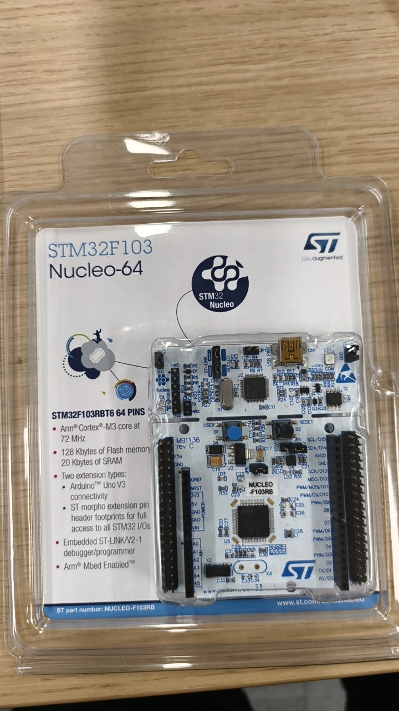
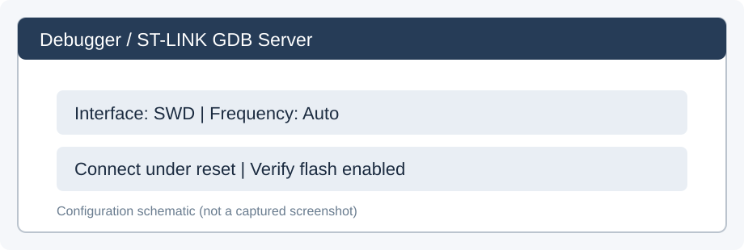
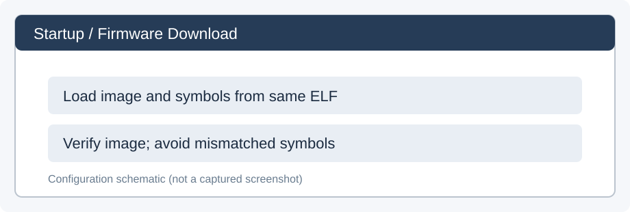
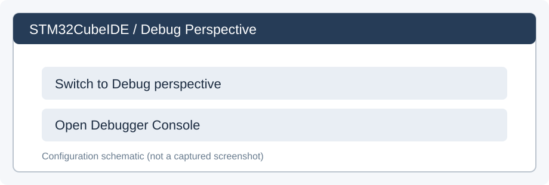
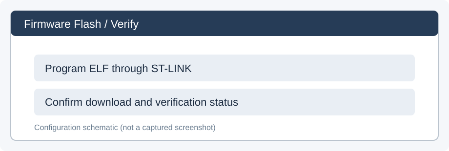
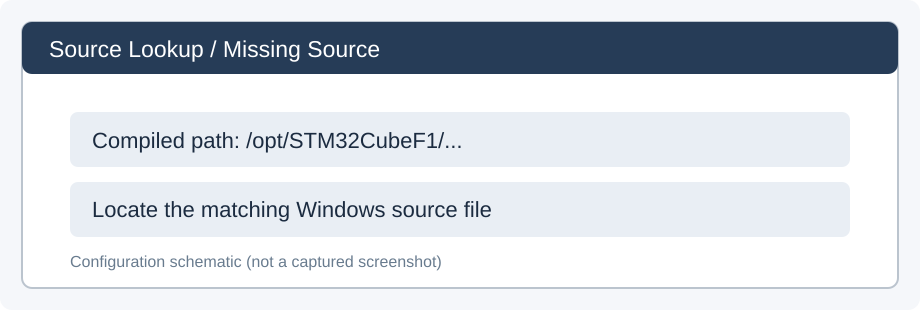
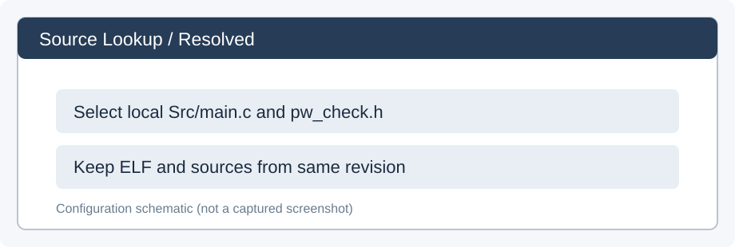
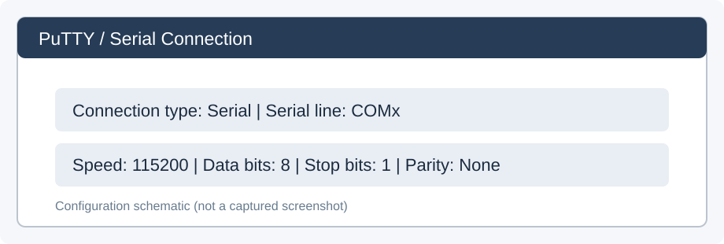
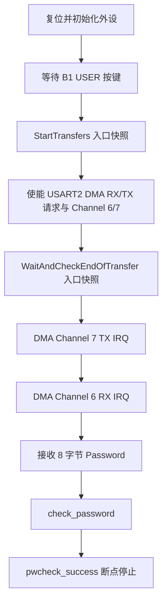

# NUCLEO-F103RB 真机烧录与 GDB 自动采集完整复现指南

> 适用目标：NUCLEO-F103RB（STM32F103RBT6，板载 ST-LINK/V2-1）  
> 测试固件：`stm32f103_usart_contiguous.elf`  
> 工具：Windows、STM32CubeIDE、PuTTY、GDB（无需 Python 支持）、PowerShell  
> 实验目的：复现 USART2 + DMA1 Channel 6/7 的初始化、数据发送与接收、DMA 中断及 `check_password` 成功路径，并留存 GDB 证据。  

## 0. 复现范围与结果判据

本流程是 **GDB 事件/寄存器快照采集**，不是完整指令轨迹或完整基本块执行序列。CPU 在命中断点时暂停，外设可能仍在工作；因此日志不提供周期精度保证。

成功运行时，日志记录以下关键状态（后文将说明怎么检查）：

| 事件 | 预期检查结果 |
|---|---|
| 进入 `StartTransfers()` | DMA RX 待收 8 字节，TX 待发 167 字节；通道 EN=0 |
| 进入 `WaitAndCheckEndOfTransfer()` | USART2 CR3=`0xC0`；DMA Ch6/Ch7 EN=1；TX 的 CNDTR7=0 |
| TX 完成中断 | `DMA1_Channel7_IRQHandler()` 被命中 |
| RX 完成中断 | `DMA1_Channel6_IRQHandler()` 被命中；CNDTR6=0；缓冲区为 `Password` |
| 开始密码验证 | `ubTransmissionComplete=1`，`ubReceptionComplete=1` |
| 密码匹配成功 | `num_correct=8`，命中 `pwcheck_success()` |

重要：`pwcheck_success()` 后面故意向无效地址 `0x77889900` 写数据。**脚本会停在该函数入口；成功后不要继续 Resume**，否则可能进入 HardFault。这是 Fuzzware 固件故意设计的触发逻辑。



> 文中 IDE 和 PuTTY 插图为配置示意图，用于说明操作位置与参数，并非软件界面实拍。

## 1. 准备硬件与连接

1. 核对开发板丝印和包装：`NUCLEO-F103RB` / `STM32F103RBT6`。本流程不是 STM32F103C8T6 Blue Pill 的操作说明。
2. 检查板载 ST-LINK 与目标 MCU 之间的 **CN2 两个跳帽**处于板卡正常使用位置；USB 供电时根据板卡版本核实 **JP5 的 U5V** 配置（具体以 MB1136 板卡说明为准）。
3. 通过**具有数据传输功能的 Mini-USB B 线**，将 Nucleo 的 **CN1/ST-LINK USB** 连接 Windows 电脑。默认布线同时用于 ST-LINK SWD 调试和 USART2 VCP 串口，因此不需另接 USB-TTL。
4. 在 Windows 中按 `Win + X` → **设备管理器** → **端口（COM 和 LPT）**，寻找 `STMicroelectronics STLink Virtual COM Port (COMx)`，记下真实 `COMx`。例如 `COM5` 仅为示例，实际应使用设备管理器显示的端口。
5. 如果无 COM 端口，检查 USB 线、ST-LINK 驱动、CN2、板卡焊桥和 Windows 识别情况。默认情况下 USART2 的 PA2/PA3 接到板载 VCP；板卡若改焊桥则不一定成立。

## 2. 准备实验文件和保存目录

### 2.1 文件

- 已编译 ELF：`stm32f103_usart_contiguous.elf`，使用**与调试符号匹配的 ELF**；不要为了查看源代码直接重新 Build。
- 上游源代码：<https://github.com/fuzzware-fuzzer/gdma-experiments/tree/main/src/02-extended-test-suite/targets/STM32F103/stm32f103_usart_dma_build_dir>
- 板卡说明：<https://github.com/IoTS-P/IoT-Boards/blob/main/Boards/STM32/NUCLEO_F103RB/README.md>
- 教程配套文件：`stm32f103_dma_trace.gdb`（GDB 寄存器采集脚本）、`clean_stm32_trace.ps1`（日志清理脚本）、`stm32f103_dma_trace.clean.log`（成功运行示例日志）、`images/`（配置示意图）。

### 2.2 创建本地目录

打开 **PowerShell**（不是 GDB Console），执行：

```powershell
New-Item -ItemType Directory -Force 'D:\stm32-trace'
```

把两个脚本复制到：

```text
D:\stm32-trace\
├── stm32f103_dma_trace.gdb
└── clean_stm32_trace.ps1
```

正式实验建议同时保存 ELF 的 SHA-256：

```powershell
Get-FileHash 'D:\实际路径\stm32f103_usart_contiguous.elf' -Algorithm SHA256
```

将 `D:\实际路径\...` 替换为自己电脑上的真实路径。还应记录板卡硬件修订、IDE 版本、GDB 版本、固件源码 commit、测试日期和 COM 端口。

## 3. 在 STM32CubeIDE 导入 ELF

1. 打开 STM32CubeIDE。
2. `File → Import...`，查找 `C/C++ → STM32 Cortex-M Executable`（不同版本可能名称略有不同），导入本地 `stm32f103_usart_contiguous.elf`。
3. 目标选择 **STM32F103RB / STM32F103RBTx**，不要误选 F103C8。
4. `Run → Debug Configurations...`，在左侧 `STM32 C/C++ Application` 选刚导入 ELF 对应的 Debug 配置。
5. 在 Main/相关页面确认 **Application 指向正确 ELF 文件**，不是过往其他固件。

## 4. 配置 Debugger 与 Startup

### 4.1 Debugger 页面

建议配置如下：

| 配置项 | 值 | 说明 |
|---|---|---|
| 调试服务器 | ST-LINK GDB Server | IDE 自动启动，不同时启动 OpenOCD |
| 接口 | SWD | 板载 ST-LINK |
| Frequency | Auto | 连接不稳定才尝试调低 |
| Access Port | `0 - Cortex-M3` | 保持默认 |
| Reset behaviour | Connect under reset | 便于连接异常固件 |
| Semihosting | Disabled | 当前用 USART2 VCP 传数据 |
| Verify flash download | Enabled | 下载后做 Flash 校验 |
| Incremental flash programming | Disabled | 保持既有测试配置 |
| Enable live expressions | Disabled | 减少不必要的实时调试读操作 |
| SWV | Disabled | 本流程用 GDB 断点采集，不需要 PC Sampling |



*图 1．Debug 会话中使用的 Debugger 配置示意图。正式采集时保持 SWV 关闭。*

**不要把 SWD Frequency 和 USART 波特率混淆**：SWD 是调试接口时钟；PuTTY 的 `115200` 才是串口波特率。

### 4.2 Startup 页面

1. 保持 ELF 下载及符号加载选项启用（不同 IDE 版本显示为 Download / Load symbols / Load Image and Symbols）。
2. 保持默认启动地址。
3. **取消 `Set breakpoint at main`**，避免自动断点占用资源；如果为了调试 `main()` 已开启，测试前应手动删除。
4. 保持合适的 Resume/启动选项；如 IDE 下载后停住，之后可人工按 F8。
5. 点击 `Apply` 保存。



*图 2．Startup 页面，注意截图中 `Set breakpoint at main` 可能被勾选；为避免与六个脚本断点冲突，正式采集应取消该选项。*

## 5. 烧录并进入 Debug

1. 在 Debug Configurations 页面点击 **Debug**（或 IDE 工具栏的 Debug 图标）。
2. 如弹出 `Confirm Perspective Switch`，选择 **Switch** 进入 Debug 视图。这不是报错。

   

   *图 3．点击 Switch 进入调试视图。*
3. 在 Console / ST-LINK GDB Server 输出中确认：

   ```text
   File download complete
   Download verified successfully
   ```

   这仅证明 Flash 下载和校验成功，**不是业务测试通过**。

   

   *图 4．Console 出现 `Download verified successfully` 时的界面。*
5. 左侧 Debug 视图应出现当前 ELF、`Thread #1`、`arm-none-eabi-gdb` 和 ST-LINK GDB Server。
6. 如果中间出现 `Go hunt your bugs here.`，通常是未打开源码或程序正在运行，不代表失败。
7. 注意按钮区别：**Suspend** 是暂停 MCU；**Resume (F8)** 是继续运行；**Terminate** 是结束调试会话。出现 `<terminated>` 就要重新 Debug。

## 6. 关联源码（解决 Source not found）

### 6.1 下载上游源码

PowerShell 中可以使用 `git`（已安装 Git 时）：

```powershell
cd D:\Github
git clone https://github.com/fuzzware-fuzzer/gdma-experiments.git
```

也可以从 GitHub 网页点击 `Code → Download ZIP`，然后解压。若已克隆仓库，不用重复执行。源代码主要在：

```text
D:\Github\gdma-experiments\src\02-extended-test-suite\targets\STM32F103\stm32f103_usart_dma_build_dir\Src\
```

该目录包含 `main.c`、`stm32f1xx_it.c`、`pw_check.h` 等。

### 6.2 添加 Source Lookup

1. `Run → Debug Configurations... → 目标配置 → Source`。
2. 点击 `Add... → File System Directory`，选择 `stm32f103_usart_dma_build_dir`，启用递归搜索（如有）；或者分别添加 `Src` 和 `Inc`。
3. 点击 `Apply`。调试暂停时，在左侧 Debug 树展开线程/栈帧并双击 `main()`。
4. 若仍提示 `Source not found`，使用弹窗的 `Locate File...`，手动指向 `Src\main.c`。可使用该办法打开 `main.c`。


*图 5．编译时的 Linux 路径 `/opt/STM32CubeF1/...` 与 Windows 源码目录不一致时出现的提示。*



*图 6．使用 Source Lookup/Locate File 后，已在编辑器中打开实验人员本地 `main.c`。*

5. 如果 GDB 提示找不到 `/opt/STM32CubeF1/Drivers/...` 下的 `stm32f1xx_ll_utils.c`，该文件属于 STM32CubeF1 驱动仓库，而非项目自己的 `Src`。应下载与 ELF 匹配的驱动源码后定位；也可在 GDB Console 执行路径映射，例如：

   ```gdb
   set substitute-path /opt/STM32CubeF1 D:/Github/STM32CubeF1
   ```

   仅在电脑真实路径确实为 `D:/Github/STM32CubeF1` 时使用上述命令。

**版本警告说明**：`warning: Source file is more recent than executable.` 仅说明本地源文件修改时间晚于 ELF，不直接证明内容错误。正式实验应记录 ELF 哈希和匹配的 Git commit，不要在不核实的情况下重新编译。

## 7. 清除多余断点，避免硬件断点数量不足

STM32F103 的 Flash 代码断点主要使用有限的 Cortex-M3 硬件断点。之前的实验出现过 `Maximum number of supported hardware breakpoints reached`，原因是手动断点和脚本断点重复。


*图 7．示例硬件断点不足提示。*

1. STM32CubeIDE：`Window → Show View → Breakpoints`，删除手动建立的断点，尤其是 `main`、`StartTransfers`、DMA 中断、密码校验处的多余断点。
2. 进入 **Debugger Console**（不是 ST-LINK GDB Server 输出控制台），执行：

   ```gdb
   info breakpoints
   ```

3. 如果确有多余断点，可通过 `delete <编号>` 精确删除，例如 `delete 3`；如果确认要删掉**全部 GDB 断点**，使用：

   ```gdb
   delete breakpoints
   ```

4. **加载脚本之前**再次 `info breakpoints` 检查，最好为空。不要在同一 GDB 会话中反复 `source` 同一个脚本，否则又会建立重复断点。

## 8. 加载自动采集 GDB 脚本

`stm32f103_dma_trace.gdb` 使用纯 GDB 命令，不依赖 Python。

1. 确保 `D:\stm32-trace\` 已存在且有写入权限，脚本确实位于该目录。
2. 在 Debugger Console 输入：

   ```gdb
   source D:/stm32-trace/stm32f103_dma_trace.gdb
   ```

3. 应显示六个断点的创建信息和 `TRACE INSTALLED`。提供的日志显示断点编号 1–6，地址依次为 `0x08000628`、`0x0800075c`、`0x080008bc`、`0x080008e0`、`0x08000358`、`0x080002c4`。编号仅对本轮有效。
4. 输入：

   ```gdb
   info breakpoints
   ```

   检查 `Enb` 为 `y`，断点分别位于：

   | 断点目标 | 事件采集意义 |
   |---|---|
   | `StartTransfers` | DMA 使能前 |
   | `WaitAndCheckEndOfTransfer` | `StartTransfers` 返回后（下一函数入口） |
   | `DMA1_Channel7_IRQHandler` | TX 中断入口 |
   | `DMA1_Channel6_IRQHandler` | RX 中断入口 |
   | `check_password` | 密码验证开始前 |
   | `pwcheck_success` | 密码匹配全部成功，在非法写入前停止 |

   断点编号不一定是 1–6，以真实 `info breakpoints` 输出为准。

**提醒**：`set logging enabled on` 在 CubeIDE 的 GDB/MI 模式下可能将 `~"..."` 协议行写进原始日志，这不是采集失败；使用 PowerShell 脚本离线清理。`USART2_DR` 被故意排除在自动读取外，以防读取引发 RXNE/错误标志变化，数据从 DMA RAM 缓冲区读取。

## 9. 复位 MCU，开始正式采集

启动时 GDB 可能已经在运行，所以应先让 MCU 暂停：在 Debug 树选中 Thread，点击 **Suspend**。

在 Debugger Console 依次执行：

```gdb
monitor reset
```

这会请求 ST-LINK GDB Server 做目标系统复位。复位之后，检查 Debug 线程状态：

- 如果 MCU 已经继续运行，不要重复输入 `continue`。
- 如果 MCU 暂停，则输入：

  ```gdb
  continue
  ```

接下来等待固件的 `WaitForUserButtonPress()` 阶段，按开发板上的 **蓝色 B1 USER** 按钮触发 `StartTransfers()`。脚本在前五个检查点采集后自动 `continue`，不需要逐一手动 Resume。

**不要按 Windows 的停止按钮来“复位”**，也不要在已经命中成功检查点后 Resume。

## 10. 打开 ST-LINK 虚拟串口并发送输入

### 10.1 PuTTY 配置

1. 打开 Windows「设备管理器」，找到本板的 `STLink Virtual COM Port (COMx)`。
2. 启动 PuTTY，在 Session 中选择 `Serial`。
3. `Serial line`：填真实端口，例如 `COM5`（仅示例）。
4. `Speed`：**115200**。
5. `Connection → Serial`：`Data bits=8`、`Stop bits=1`、`Parity=None`、`Flow control=None`。
6. 点击 `Open`。黑色窗口不代表出错，PuTTY 默认可能不显示本地键入的字符。

波特率来自上游代码 `LL_USART_SetBaudRate(USART2, SystemCoreClock/2, 115200)`；USART 参数是 `115200 8N1`。需要实际芯片时钟成功配置，通信参数才会符合预期。



*图 8．PuTTY Session 配置示意图。Serial line 应填设备管理器中的实际 COM 号，Speed 设为 115200；Connection → Serial 设为 8N1、Flow control=None。此图为操作示意，不是测试截图。*

### 10.2 按顺序输入

1. 完成上节的 MCU 复位与 Resume。
2. 按 B1 USER，触发传输。**确保 `StartTransfers` 已执行，RX DMA 已使能**；最好在 GDB 日志或运行状态中确认 `WaitAndCheckEndOfTransfer ENTRY` 已被采集。
3. 确认 MCU 此时正在运行，不能仍暂停在等待循环中。
4. 切到 PuTTY 窗口，输入大小写严格匹配的：

   ```text
   Password
   ```

5. **不要按 Enter，不要多输入空格或其他字符。** 输入恰好 8 个 ASCII 字节：

   ```text
   50 61 73 73 77 6F 72 64
   ```

6. 之后程序应进入 DMA Channel 6 RX 中断、`check_password` 和 `pwcheck_success`，最终在成功检查点自动暂停。

如果需要严格可复现的二进制发送（避免交互式键盘输入抖动或多余字符），可以改用串口工具的 HEX 发送功能，或在安装 `pyserial` 后使用以下命令（`COM5` 要改成实际端口，且不要与 PuTTY 同时占用同一 COM）：

```powershell
py -m pip install pyserial
py -c "import serial; s=serial.Serial('COM5',115200,timeout=1); n=s.write(b'Password'); s.flush(); print('sent bytes:', n); s.close()"
```

只有发送了 8 字节并得到真机断点证据后，才能认定复现通过。

## 11. 查看原始日志并解码

### 11.1 日志位置

脚本记录到：

```text
D:\stm32-trace\stm32f103_dma_trace.log
```

注意 GDB/MI 可能使原始日志出现 `~"...\n"`、`=breakpoint-modified`、`*running` 等控制消息，它们是 IDE 与 GDB 的通信封装，不是 MCU 数据格式。

### 11.2 清理日志

在 **PowerShell** 中执行（不是 GDB Console）：

```powershell
powershell -ExecutionPolicy Bypass -File D:/stm32-trace/clean_stm32_trace.ps1
```

预期产生：

```text
D:\stm32-trace\stm32f103_dma_trace.clean.log
```

这个离线脚本只清除 MI 协议包装并保留控制台采集文本，不会改变固件或原始日志。**原始日志与清理后日志建议同时保存**。

### 11.3 检查事件完整性

在 PowerShell 中可以执行：

```powershell
Select-String -Path 'D:\stm32-trace\stm32f103_dma_trace.clean.log' -Pattern '===== EVENT','num_correct','ubReceptionComplete','DMA1_CNDTR6'
```

或用记事本打开清理后的日志。脚本输出中每个寄存器会带名称与地址，例如：

```text
DMA1_CCR6   [0x4002006C] = 0x0000208b
DMA1_CNDTR6 [0x40020070] = 0x00000000
DMA1_CPAR6  [0x40020074] = 0x40004404
DMA1_CMAR6  [0x40020078] = 0x2000000c
```

文件中的具体数值以实际采集为准；以上数值也能在提供的成功日志中核对，重新复现时仍以新产生的日志为准。

## 12. 如何判断通过：六个检查点

以下数值对应配套的 `stm32f103_dma_trace.clean.log`，用于核对相同固件和测试输入下的执行结果。

| 检查点 | 关键记录 | 解释 |
|---|---|---|
| `StartTransfers ENTER` | `CR3=0`；`CCR6=0x208A`，`CNDTR6=8`；`CCR7=0x209A`，`CNDTR7=0xA7` | DMA 请求与通道未使能，接收长度为 8，发送长度为 167 |
| `WaitAndCheckEndOfTransfer ENTRY` | `CR3=0xC0`；`CCR6=0x208B`；`CCR7=0x209B`；`CNDTR7=0` | USART2 DMA 请求使能，发送 DMA 计数耗尽 |
| TX IRQ | `DMA1_ISR=0x07000000`，`TCIF7=1`；`ubTransmissionComplete=0` | DMA 已触发发送完成中断；尚未执行中断函数中的软件完成标志更新 |
| RX IRQ | `DMA1_ISR=0x00700000`，`TCIF6=1`；`CNDTR6=0`；缓冲区为 `Password` | DMA 接收完成；中断入口处软件完成标志尚未更新 |
| `check_password` | `ubTransmissionComplete=1`，`ubReceptionComplete=1`，`num_correct=0` | 收发中断处理完成，进入密码检查 |
| `pwcheck_success` | `num_correct=8`；调用栈包含 `check_password` | 密码全部匹配，进入成功函数 |

USART2 `SR=0xC0` 表示 TXE、TC 标志置位；`SR=0xD0` 还包含 IDLE 标志（bit 4），不能误认为 RXNE（bit 5）。DMA1 ISR 中 Channel 6 对应 bit 20–23，Channel 7 对应 bit 24–27；GDB 脚本的标志位解码使用上述定义。

### 12.1 六个事件及关键数值

| 顺序 | 事件 / PC | CR3 | DMA1 ISR | CNDTR6 (RX) | CNDTR7 (TX) | 完成变量 (TX, RX) | 密码匹配 |
|---:|---|---|---|---:|---:|---|---:|
| 1 | `StartTransfers` / `0x08000628` | `0x00` | `0x00000000` | 8 | 167 | 0, 0 | 0 |
| 2 | `WaitAndCheckEndOfTransfer` / `0x0800075c` | `0xC0` | `0x07000000` | 8 | 0 | 0, 0 | 0 |
| 3 | `DMA1_Channel7_IRQHandler` / `0x080008bc` | `0xC0` | `0x07000000` | 8 | 0 | 0, 0 | 0 |
| 4 | `DMA1_Channel6_IRQHandler` / `0x080008e0` | `0xC0` | `0x00700000` | 0 | 0 | 1, 0 | 0 |
| 5 | `check_password` / `0x08000358` | `0xC0` | `0x00000000` | 0 | 0 | 1, 1 | 0 |
| 6 | `pwcheck_success` / `0x080002c4` | `0xC0` | `0x00000000` | 0 | 0 | 1, 1 | **8** |

第 4 个检查点记录的 RX 缓冲区为 `50 61 73 73 77 6F 72 64`（ASCII `Password`）。第 6 个检查点调用栈显示 `main → WaitAndCheckEndOfTransfer → check_password → pwcheck_success`。

### 12.2 执行事件示意图



*图 9．依据实验日志的六个检查点整理的事件示意图；并非连续指令级执行轨迹。GitHub Markdown 支持 Mermaid 渲染。*

### 12.3 日志与插图文件

`images/` 提供 Debugger、Startup、烧录校验、源码定位、断点错误及 PuTTY 配置等插图。`stm32f103_dma_trace.clean.log` 是完整的成功测试示例，包含六个事件的寄存器状态和调用栈。PuTTY 插图为配置示意图，串口号必须按实际 Windows 设备管理器选择。

## 13. 故障与处理

| 症状 | 排查与解决 |
|---|---|
| `Go hunt your bugs here.` | 不是烧录失败；Suspend 后展开调用栈、双击栈帧 |
| `Source not found` | 添加 Source Lookup，或使用 Locate File 指向本地 `main.c` |
| `Source file is more recent than executable` | 文件时间戳不一致；记录 ELF 哈希与源码 commit；不要直接认定功能错误 |
| `Maximum number of supported hardware breakpoints reached` | Breakpoints 视图和 `info breakpoints` 查重复断点；删除多余断点后重新 `source` |
| 断点不明原因出现 | IDE 恢复多余断点或加载脚本；在 Breakpoints 视图中删除，并检查 `info breakpoints` |
| `Python scripting is not supported` | 使用本包纯 GDB 脚本，**不要**执行 `python ...` |
| 日志只有 `TRACE INSTALLED` | 只记录了安装阶段；检查是否已 `monitor reset`、继续运行、按下 B1、发送数据；注意看 `times` 是否增加 |
| 日志带 `~"..."` | GDB/MI 封装；用 `clean_stm32_trace.ps1` 离线解码 |
| RX 一直等待，`CNDTR6=8` | 串口可能没有输入，或接收通道未使能；检查 VCP、按钮、115200 8N1 和 `CR3`/`CCR6` |
| `0 < CNDTR6 < 8` | 只收到部分数据；检查是否发送恰好八字节、有没有多余字符 |
| `CNDTR6=0` 但 `ubReceptionComplete=0` | 若停在 RX IRQ **入口**属于正常；继续后再检查回调；如果一直不更新，再排查 ISR |
| 命中 `pwcheck_success` | 记录成功后停止，不继续执行无效地址写入 |
| Terminate 后脚本/断点消失 | 重新 Debug，然后重新 `source`（一轮会话只加载一次） |

## 14. 建议保存的复现证据

一次正式实验至少保留：

1. 开发板型号与板卡修订、ST-LINK 类型、PC 操作系统、CubeIDE 版本、串口 COM 号。
2. `stm32f103_usart_contiguous.elf` 的实际文件、SHA-256、与源码对应的 Git commit。
3. 当前使用的 `.gdb`、`.ps1` 文件（建议同样保存 SHA-256）。
4. 原始 `stm32f103_dma_trace.log` 和解码后的 `.clean.log`。
5. 测试输入的精确字节串 `50 61 73 73 77 6F 72 64`，以及是否通过 PuTTY 或 `pyserial` 发送。
6. 成功检查点处的 GDB 调用栈、`num_correct`、RX 缓冲区和 DMA ISR/CNDTR 等数据。

**结论边界**：这能证明该输入下的 USART2 DMA 功能事件和密码检查路径在真机上出现；不能直接作为完整 BB 执行轨迹，也不能作为未插桩固件所有输入下的功能正确性证明。

## 参考链接

- 开发板 README：<https://github.com/IoTS-P/IoT-Boards/blob/main/Boards/STM32/NUCLEO_F103RB/README.md>
- Fuzzware 上游源码：<https://github.com/fuzzware-fuzzer/gdma-experiments/tree/main/src/02-extended-test-suite/targets/STM32F103/stm32f103_usart_dma_build_dir>
- STM32CubeF1 官方驱动：<https://github.com/STMicroelectronics/STM32CubeF1>
- ST Nucleo-64 MB1136 手册：<https://www.st.com/resource/en/user_manual/dm00105823-stm32-nucleo-64-boards-mb1136-stmicroelectronics.pdf>

