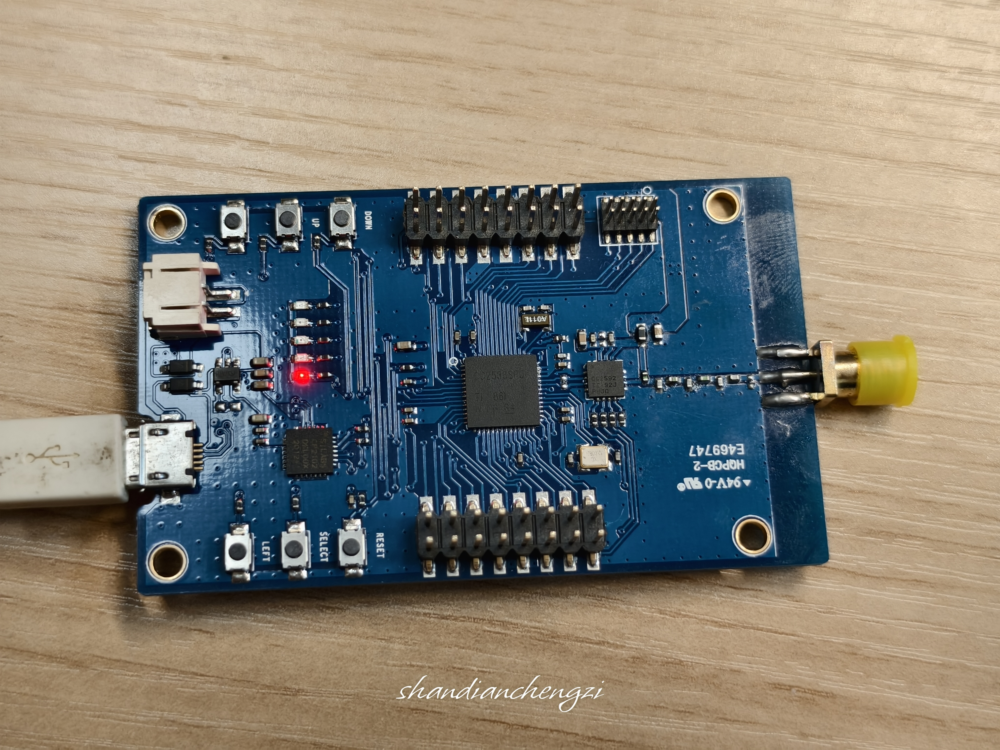
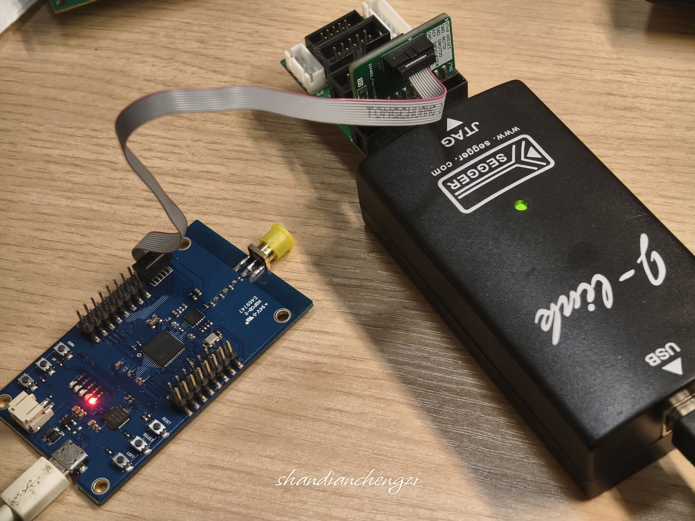
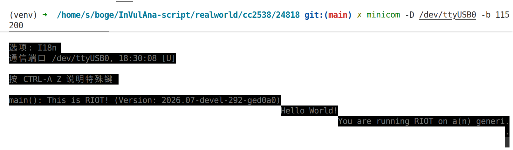

# CC2538SF53 烧录与串口连接指南

## 硬件环境

- **MCU**: CC2538SF53 (512KB Flash, 32KB SRAM)
- **调试器**: JLink (需要10pin转20pin适配器)
- **串口设备**: /dev/ttyUSB0

## 软件环境

### 1. 安装依赖

```bash
# 安装 pyserial (cc2538-bsl 依赖)
pip install pyserial

# 或使用 venv
python -m venv venv
source venv/bin/activate
pip install pyserial
```

### 2. 下载 cc2538-bsl 烧录工具

下载安装最新版：
```bash
git clone https://github.com/JelmerT/cc2538-bsl.git
```

或由RIOT OS控制安装过程：参考[Generic CC2538-CC2592-DK Board](https://api.riot-os.org/group__boards__generic__cc2538__cc2592__dk.html)。该文档中文版翻译见本仓库[Generic CC2538-CC2592-DK Board](./Generic%20CC2538-CC2592-DK%20Board.md)。运行以下指令：

```shell
git clone git@github.com:RIOT-OS/RIOT.git
cd RIOT
cd examples/basic/hello-world
BOARD=generic-cc2538-cc2592-dk make flash
```


### 3. 设置串口权限

如果遇到权限问题（如 "Permission denied: '/dev/ttyUSB0'"），可以临时或永久解决：

#### 临时权限（重启后失效）

```bash
sudo chmod 666 /dev/ttyUSB0
```

#### 永久权限（推荐）

```bash
# 将当前用户加入 dialout 组
sudo usermod -aG dialout $USER

# 重新登录或重启生效
# 验证是否生效
groups  # 应该能看到 dialout
```


## 测试固件信息

- **操作系统**: RIOT OS 2022.07
- **固件文件**: [hello-world.bin](./hello-world.bin)
- **ELF文件**: [hello-world.elf](./hello-world.elf)

## 烧录方法一：使用 cc2538-bsl 工具

### 1. 连接设备

确保 CC2538-CC2592-DK Board 已连接，检查串口设备：

```bash
ls /dev/ttyUSB*
# 应该显示 /dev/ttyUSB0
```



### 2. 进入 BSL 模式

CC2538 需要先进入 BSL（Bootstrap Loader）模式才能烧录：

1. **按住 `select` 按钮**（不要松手）
2. **按下 `EM reset` 按钮**（按下后立即松开）
3. **保持 `select` 按钮按住约 1 秒**后松开
4. 此时 CC2538 已进入 BSL 模式，在 **2 秒内**可以执行烧录命令

> 进入 BSL 模式时，这块板子很可能会亮起蓝色的 LED，表示已成功进入 BSL 模式。但是如果没有亮起，或者亮起了也烧录不了，也是正常的。按照上述步骤操作即可进入 BSL 模式，如果此时还是烧录不了，通常不是这个问题，建议更换烧录方式，或者换一块板子。

> ⚠️ 注意：进入 BSL 模式后需要在 2 秒内开始烧录，否则会超时退出。

### 3. 执行烧录

```bash
# 进入 venv
source venv/bin/activate

# 烧录固件
python cc2538-bsl/cc2538_bsl/cc2538_bsl.py \
    -e \
    -w \
    -v \
    -p /dev/ttyUSB0 \
    -b 460800 \
    hello-world.bin
```

#### 参数说明

| 参数 | 说明 |
|------|------|
| `-e` | 擦除 Flash |
| `-w` | 写入固件 |
| `-v` | 验证写入 |
| `-p /dev/ttyUSB0` | 指定串口 |
| `-b 460800` | 烧录波特率 |

### 4. 烧录输出示例

```
Opening port /dev/ttyUSB0, baud 460800
Reading data from /home/s/boge/IoT-Boards/Boards/TI/CC2538-CC2592-DK/hello-world.bin
Cannot auto-detect firmware filetype: Assuming .bin
Connecting to target...
CC2538 PG2.0: 512KB Flash, 32KB SRAM, CCFG at 0x0027FFD4
Primary IEEE Address: 00:12:4B:00:19:40:B9:E4
    Performing mass erase
Erasing 524288 bytes starting at address 0x00200000
    Erase done
Writing 524288 bytes starting at address 0x00200000
Write 16 bytes at 0x0027FFF0F8
    Write done                                
Verifying by comparing CRC32 calculations.
    Verified (match: 0xfe6325df)
```

## 烧录方法二：使用 J-Link 调试器

需要连接板子上的10pin接口，所以需要一个10pin转20pin的适配器。

需要检查三处连接：
1. J-Link的USB连接电脑；
2. J-Link的JTAG接口连接适配器的20pin接口；
3. CC2538-CC2592-DK开发板的10pin接口接适配器的10pin接口（注意方向，板子上对应接口有一处断点的那侧，要与线的凸点的那侧保持一致；



然后，使用以下命令烧录：

```shell
BOARD=generic-cc2538-cc2592-dk make flash PROGRAMMER=jlink
```

## 串口连接

### 连接方式

```bash
# 使用 minicom
minicom -D /dev/ttyUSB0 -b 115200
# 退出 minicom: Ctrl+A, 然后按 q

# 使用 screen
screen /dev/ttyUSB0 115200

# 使用 picocom
picocom -b 115200 /dev/ttyUSB0
```



### 注意事项

1. **波特率**: 固件运行时波特率为 **115200**（与烧录波特率 460800 不同）
2. **串口权限**: 需要 dialout 组权限或使用 sudo
3. **复位设备**: 烧录后可能需要按 RESET 按键或重新上电

## 固件功能

该固件基于 RIOT OS，包含以下功能：

- Shell 命令行界面
- UART 串口通信
- 6LoWPAN 网络支持
- GNRC 网络栈

### Shell 命令

连接串口后，输入 `help` 查看可用命令。

## 常见问题

### Q: Permission denied: '/dev/ttyUSB0'

```bash
# 临时解决
sudo chmod 666 /dev/ttyUSB0

# 永久解决
sudo usermod -aG dialout $USER
# 然后重新登录
```

### Q: minicom 立即退出

通常是权限问题，参考上面的解决方案。

### Q: 烧录后无串口输出

1. 确认波特率为 115200
2. 按 RESET 按键复位设备
3. 检查 USB 连接是否稳定

### Q: Cannot auto-detect firmware filetype

正常提示，不影响烧录，会默认按 .bin 处理。
