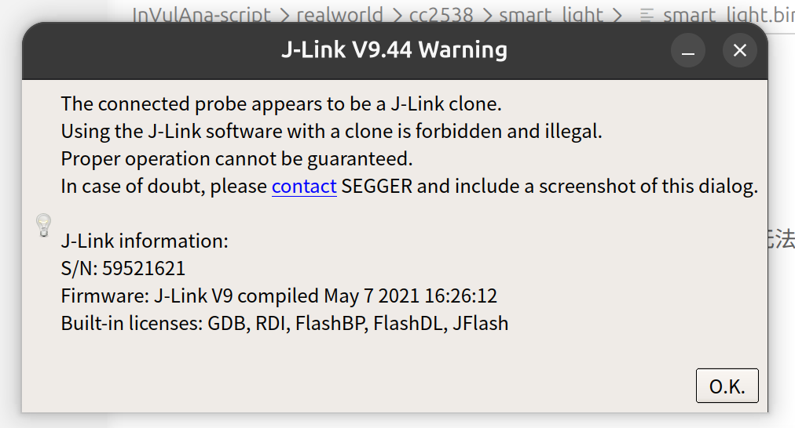

主要看手册就好，这个手册讲得非常详细。J-Link 手册(UM08001) V9.46 [2026-05-27]：[https://www.segger.com/downloads/jlink/UM08001](https://www.segger.com/downloads/jlink/UM08001) or [./UM08001_JLink.pdf](./UM08001_JLink.pdf)(本地备份)。

看完安装过程之后，可以从First Steps章节开始看，里面有很多关于使用J-Link的细节和示例。

这张图片报的错（当前JTag为盗版）不要紧：
